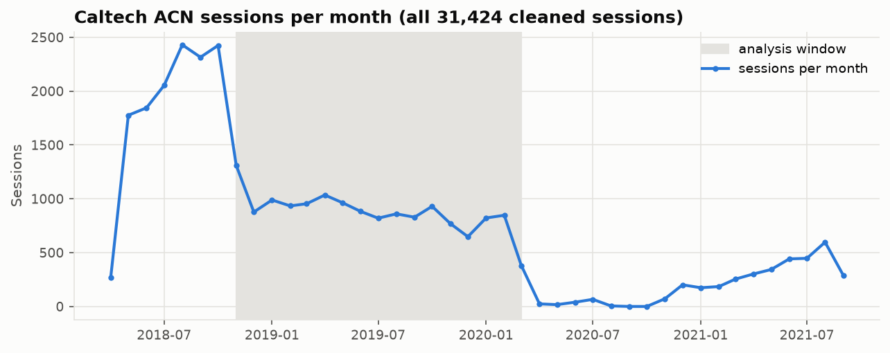
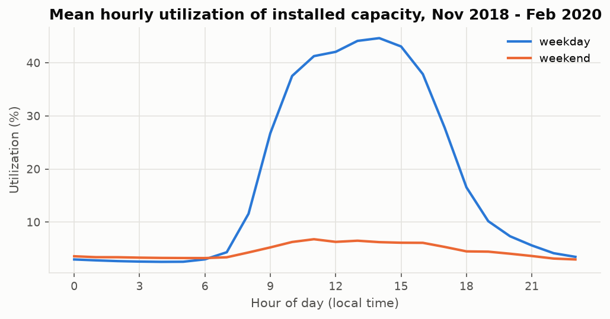
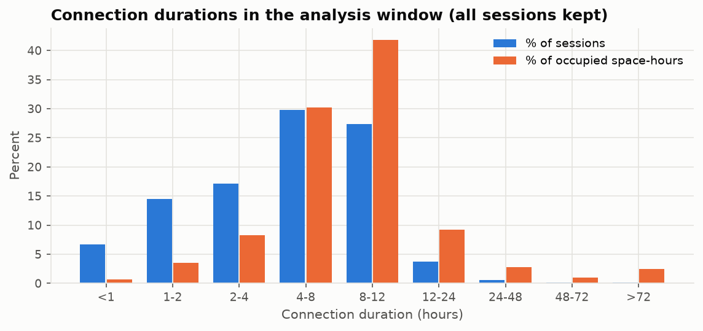
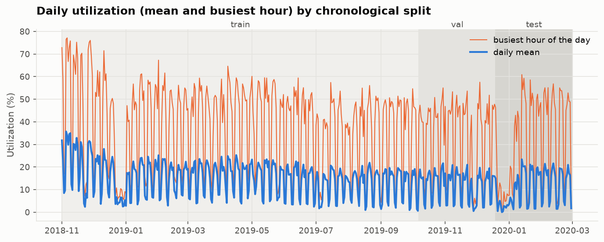

# Preprocessing Report — Caltech ACN-Data

_Generated by `ml-service/preprocess.py` at 2026-10-10T11:32:17+00:00. All numbers come from the run; do not edit by hand._

## 1. Source and scope

- **Dataset:** ACN-Data, Caltech Adaptive Charging Network (https://ev.caltech.edu/dataset), official API export.
- **Citation:** Z. J. Lee, T. Li, S. H. Low, *ACN-Data: Analysis and Applications of an Open EV Charging Dataset*, ACM e-Energy 2019.
- **Raw file:** `dataset/raw/acn_caltech_sessions.csv` (unchanged by preprocessing). `userID` and `userInputs` were removed at download.
- **Scope:** one site (the Caltech garage). Results describe this site only, not city-wide demand. The data is **historical**, not live.

## 2. Raw-data validation (whole file)

| Check | Result |
| --- | --- |
| Records | 31,424 |
| Coverage (local) | 2018-04-25 04:08 → 2021-09-13 18:52 |
| Stations / spaces | 55 / 55 (one-to-one: True) |
| Duplicate `_id` / `sessionID` / (station, start) | 0 / 0 / 0 |
| Unparseable or missing connectionTime / disconnectTime | 0 / 0 |
| disconnectTime ≤ connectionTime | 0 |
| Missing / negative / zero kWh | 0 / 0 / 0 (min 0.501 kWh) |
| Overlapping sessions on the same space | 0 |
| Sessions starting / ending exactly on an hour | 6 / 6 |
| doneChargingTime missing | 2,055 (by year: {2018: 8, 2019: 466, 2020: 443, 2021: 1138}) |
| doneChargingTime earlier than connect / later than disconnect | 26 / 1180 |
| Timezone column | America/Los_Angeles |

Sessions with missing `doneChargingTime` have a higher median energy (11.782 kWh vs 6.588 kWh), and the field is inconsistent in 1,206 rows. It is therefore **not used anywhere**; occupancy uses connectionTime → disconnectTime only.

## 3. Cleaning (whole file)

| Step | Rows |
| --- | ---: |
| input rows | 31,424 |
| dropped missing or unparseable connectionTime | 0 |
| dropped missing or unparseable disconnectTime | 0 |
| dropped disconnect not after connect | 0 |
| dropped duplicate id | 0 |
| dropped duplicate station and connectionTime | 0 |
| dropped missing or negative kWh | 0 |
| kept flagged over 24h | 259 |
| kept flagged over 48h | 79 |
| kept missing doneChargingTime | 2,055 |
| output rows | 31,424 |

Only records that cannot describe a real occupancy interval are dropped. Long sessions and missing `doneChargingTime` are kept.

## 4. Analysis window

Local **2018-11-01 → 2020-03-01** (end exclusive): 11,665 hourly rows, 14,471 sessions starting in the window (14,479 overlapping it, including sessions that began just before it).

- **Start:** Caltech introduced a $0.12/kWh fee on 1 Nov 2018 and usage fell sharply (Lee et al. 2019, §3.1.2).
- **End:** COVID-19 campus closures collapsed demand from March 2020; the raw file has no sessions in Sep–Oct 2020.



## 5. Occupancy and utilization definition

- **Interval convention:** half-open `[connectionTime, disconnectTime)`. A session ending exactly at 10:00:00 contributes nothing to 10:00–11:00; one starting at 10:00:00 counts from 10:00.
- **occupied_spaces(h)** = Σ over spaces of (seconds occupied in hour h) / 3600 — the **time-weighted mean** number of occupied spaces during the hour, exact to the second.
- Overlapping sessions on one space are merged before counting, so a space contributes at most 1 and the total cannot exceed capacity (intervals merged: 0).
- **utilization(h)** = occupied_spaces(h) / **54** = utilization of **installed** capacity (not operational capacity, which the dataset does not record).
- Hours are built on a UTC index (no DST gaps or duplicates); calendar features use America/Los_Angeles time.
- **peak_occupied_spaces(h)** (reporting only) = maximum simultaneous occupied spaces at any instant in the hour.

| Statistic | Mean | Median | p95 | Max |
| --- | ---: | ---: | ---: | ---: |
| Occupied spaces (time-weighted) | 7.5632 | 3.0 | 26.7707 | 41.6581 |
| Utilization | 0.1401 | 0.0556 | 0.4958 | 0.7714 |

- Highest-utilization hour: 2018-11-06 13:00 local. Hours above 40% / 70% / 90%: 1,602 / 43 / 0.
- Maximum simultaneous occupancy: **43 of 54** spaces; hours at full capacity: 0. The site never ran out of chargers in this window.
- Hours with zero occupancy: 1,090.



## 6. Capacity (charger availability)

Installed capacity = **54** distinct spaces with at least one session overlapping the window (the 55th space in the raw file first appears in Nov 2020). ACN-Data has no availability/outage telemetry, so a silent space cannot be told apart from an unpopular one; outages are **not** inferred from inactivity.

Sensitivity (reporting only, never a feature or target): spaces with ≥1 session in each calendar month range 42–53. Utilization against that monthly active count: mean 0.159, max 0.786 (vs 0.1401 / 0.7714 for installed capacity).

## 7. Long sessions

All valid sessions are kept: a plugged-in vehicle occupies the space regardless of charging. Duration in the window: median 5.796 h, p95 11.714 h, max 245.269 h. Flagged: **114** sessions > 24 h and **35** > 48 h (per-session flags in `dataset/processed/session_flags.csv`).

Sensitivity series without sessions > 48 h (reporting only): mean utilization 0.1352 vs 0.1401; mean absolute hourly difference 0.00487. The main target keeps all sessions.



## 8. Holidays, outages and validity

`is_holiday` is known in advance: US federal holidays except Columbus Day and Veterans Day (normal demand at this site), plus Caltech's published Institute winter closures (24 Dec 2018 – 1 Jan 2019; 25 Dec 2019 – 1 Jan 2020).

| Holiday date | Sessions |
| --- | ---: |
| 2018-11-22 | 9 |
| 2018-12-24 | 3 |
| 2018-12-25 | 6 |
| 2018-12-26 | 6 |
| 2018-12-27 | 5 |
| 2018-12-28 | 11 |
| 2018-12-29 | 8 |
| 2018-12-30 | 10 |
| 2018-12-31 | 9 |
| 2019-01-01 | 8 |
| 2019-01-21 | 19 |
| 2019-02-18 | 19 |
| 2019-05-27 | 11 |
| 2019-07-04 | 6 |
| 2019-09-02 | 13 |
| 2019-11-28 | 1 |
| 2019-12-25 | 0 |
| 2019-12-26 | 1 |
| 2019-12-27 | 8 |
| 2019-12-28 | 5 |
| 2019-12-29 | 6 |
| 2019-12-30 | 10 |
| 2019-12-31 | 7 |
| 2020-01-01 | 5 |
| 2020-01-20 | 11 |
| 2020-02-17 | 13 |

Normal (non-holiday) weekdays: median 39 sessions/day, minimum 6.

- **Suspected outages** (non-holiday weekday with zero sessions, flag only): none found.
- **Confirmed invalid periods** excluded from sequences: none. Holidays are genuine low demand and stay in the data.
- **Lag-168 warm-up:** the first 168 hours have no value one week earlier; they are marked input-invalid. First usable input hour: 2018-11-07 23:00 local.

## 9. Features (all available at prediction time)

| Feature | Definition at input step t | Scaled |
| --- | --- | --- |
| `utilization` | observed utilization in hour t | min–max (train fit) |
| `utilization_lag_168` | utilization in hour t−168 (same hour last week) | min–max (train fit) |
| `utilization_roll_mean_24` | mean utilization over hours t−23 … t | min–max (train fit) |
| `arrivals` | sessions starting in hour t | min–max (train fit) |
| `energy_kwh_completed` | kWh of sessions that ended in hour t | min–max (train fit) |
| `hour_sin` | sin(2π·hour/24) | no (already bounded) |
| `hour_cos` | cos(2π·hour/24) | no (already bounded) |
| `dow_sin` | sin(2π·weekday/7) | no (already bounded) |
| `dow_cos` | cos(2π·weekday/7) | no (already bounded) |
| `is_weekend` | Saturday or Sunday | no (already bounded) |
| `is_holiday` | observed holiday (Section 8) | no (already bounded) |

All history features look backwards only. At the start of the validation and test periods, lag-168 and the rolling mean read hours from the preceding split — past data that would be available in deployment — and never any hour after t.

## 10. Splits, sequences and scaling

Each sample uses **24 hourly input steps** to predict **utilization 1 hour ahead**. Inputs and target always lie inside one split, and windows touching an invalid hour are skipped. Split boundaries are moved to the nearest local midnight.

| Split | Period (local) | Hours | Share | Mean util. | X shape | y shape | First → last target |
| --- | --- | ---: | ---: | ---: | --- | --- | --- |
| train | 2018-11-01 00:00 → 2019-10-06 23:00 | 8,160 | 0.6995 | 0.1508 | (7968, 24, 11) | (7968, 1) | 2018-11-08 23:00 → 2019-10-06 23:00 |
| val | 2019-10-07 00:00 → 2019-12-18 23:00 | 1,753 | 0.1503 | 0.121 | (1729, 24, 11) | (1729, 1) | 2019-10-08 00:00 → 2019-12-18 23:00 |
| test | 2019-12-19 00:00 → 2020-02-29 23:00 | 1,752 | 0.1502 | 0.109 | (1728, 24, 11) | (1728, 1) | 2019-12-20 00:00 → 2020-02-29 23:00 |

Scalers (`models/feature_scaler.pkl`, `models/target_scaler.pkl`) are fitted on **valid training rows only** and applied unchanged to validation and test.
Training-set target range: [0.0, 0.760293].



## 11. Limitations

- **Possible undercount of short plug-ins:** the smallest energy value in the whole file is 0.501 kWh, which suggests very short or zero-energy connections are absent from the source. Occupancy may be slightly underestimated; this cannot be verified from the data.
- **Installed, not operational, capacity:** chargers that were broken but counted in the 54 make utilization look lower than operational utilization.
- **Holiday coverage:** the day after Thanksgiving and 24 Dec 2019 also show low demand but are not in the verified holiday list, so `is_holiday` is 0 on those days.
- **Distribution shift:** mean utilization falls from train to validation to test; the test period contains the 2019 winter closure, while training contains only one (2018).
- **Single site:** results cannot be generalised to other sites or cities without further data.

## 12. Reproduce

```bash
cd ml-service
uv sync
uv run fetch_acn_data.py --sites caltech   # needs ACN_API_TOKEN in ml-service/.env
uv run preprocess.py
uv run pytest
```
