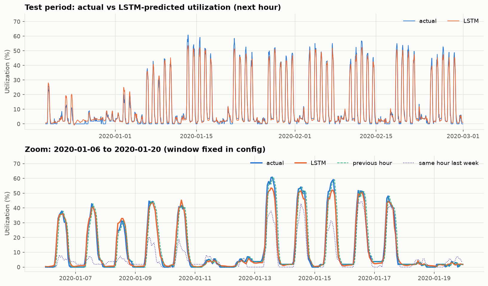
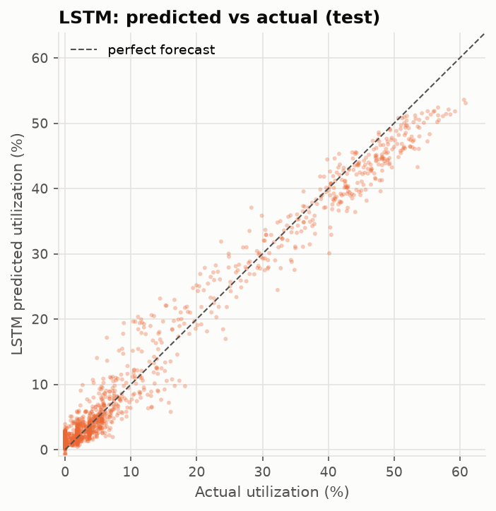
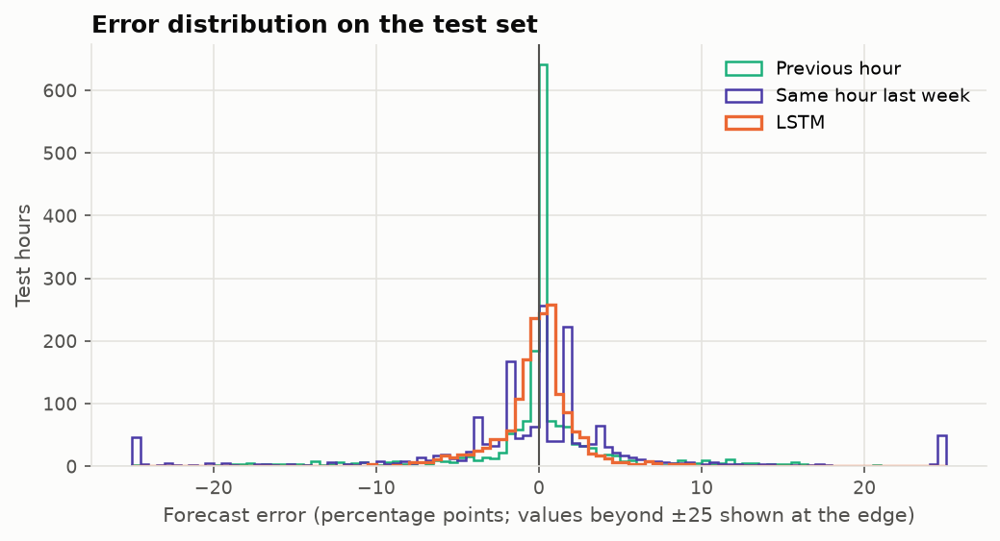
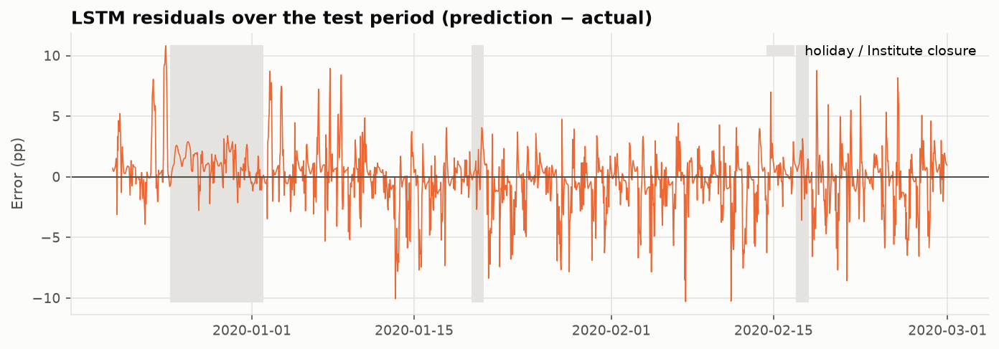
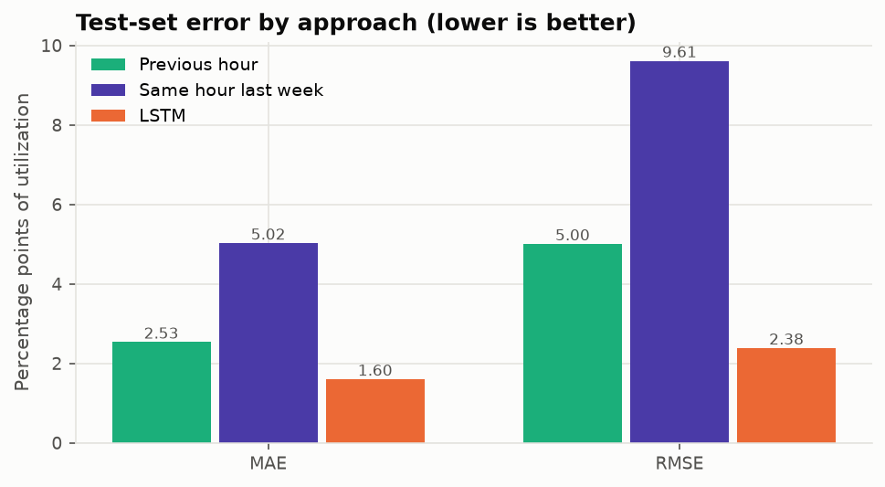
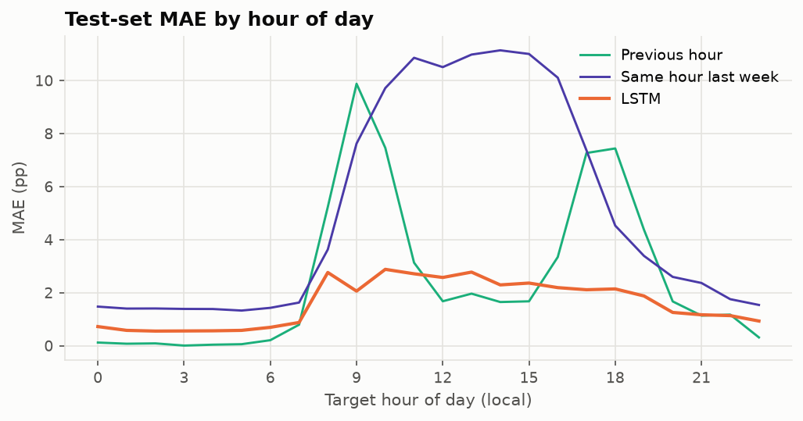

# Evaluation Report — LSTM vs baselines (test set)

_Generated by `ml-service/evaluate.py` at 2026-10-10T12:38:13+00:00. All numbers come from the run._

## Setup

- **Model:** `models/ev_demand_lstm.keras` (best epoch 111, selected on validation loss). Not retrained or tuned here.
- **Test period (target hours, local):** 2019-12-20 00:00 → 2020-02-29 23:00; **n = 1728** hourly targets, identical for all approaches.
- **Target:** next-hour utilization of 54 installed spaces. Predictions are inverse-transformed with the target scaler.
- **Baselines:** previous hour = utilization(t−1 h); same hour last week = utilization(t−168 h). Both are looked up by timestamp from the observed history.
- **Units:** MAE/RMSE in **percentage points (pp)** of utilization and in **occupied spaces** (× 54). WAPE is a **percentage error** (Σ|error| / Σ actual).
- **MAPE is not reported:** 348 test hours have zero utilization, where percentage error is undefined.

## Results

| Approach | MAE (pp) | RMSE (pp) | MAE (spaces) | RMSE (spaces) | Bias (pp) | WAPE (%) | n |
|---|---:|---:|---:|---:|---:|---:|---:|
| Previous hour | 2.533 | 5.004 | 1.37 | 2.70 | 0.000 | 23.4 | 1728 |
| Same hour last week | 5.023 | 9.611 | 2.71 | 5.19 | -0.021 | 46.3 | 1728 |
| LSTM | 1.599 | 2.384 | 0.86 | 1.29 | -0.085 | 14.7 | 1728 |

## LSTM vs each baseline

MAE difference = mean(|LSTM error| − |baseline error|); negative means the LSTM is better. 95% interval from a paired circular block bootstrap (24-hour blocks, 2000 replicates, seed 42).

| Comparison | MAE diff (pp) | 95% CI (pp) | MAE reduction | RMSE reduction | Lower MAE? | Lower RMSE? | Significant? |
|---|---:|---|---:|---:|---|---|---|
| lstm vs previous hour | -0.934 | [-1.221, -0.620] | 36.9% | 52.4% | yes | yes | yes |
| lstm vs same hour last week | -3.424 | [-4.392, -2.582] | 68.2% | 75.2% | yes | yes | yes |

## By period

| Subset | n | Previous hour MAE / RMSE (pp) | Same hour last week MAE / RMSE (pp) | LSTM MAE / RMSE (pp) |
|---|---:|---|---|---|
| weekday non holiday | 1032 | 3.80 / 6.40 | 5.59 / 9.79 | 2.01 / 2.89 |
| weekend | 504 | 0.69 / 1.23 | 2.11 / 2.78 | 0.88 / 1.18 |
| holiday | 240 | 0.57 / 1.15 | 8.10 / 15.42 | 1.28 / 1.56 |
| weekday daytime 07 19 | 559 | 6.52 / 8.62 | 8.97 / 13.15 | 3.04 / 3.81 |

## Where a baseline beats the LSTM

- Previous hour has lower MAE than the LSTM at target hours (local): 00, 01, 02, 03, 04, 05, 06, 07, 12, 13, 14, 15, 21, 23.
- Same hour last week has lower MAE than the LSTM at target hours (local): none.
- In the **weekend** subset, Previous hour has lower MAE than the LSTM (0.69 vs 0.88 pp).
- In the **holiday** subset, Previous hour has lower MAE than the LSTM (0.57 vs 1.28 pp).

## Long-session sensitivity

This measures **target-definition sensitivity of the evaluation, NOT a model trained on the alternative target**. The same LSTM predictions are scored against the alternative actual series that excludes sessions longer than 48 h. No model was trained on that target.

- The two targets differ in 695 of 1728 test hours (mean |difference| 0.247 pp, max 1.85 pp).
- LSTM vs alternative target: MAE 1.670 pp, RMSE 2.418 pp, bias 0.162 pp (vs 1.599 / 2.384 / -0.085 pp on the main target).

## Other diagnostics

- LSTM raw prediction range: -0.80% to 53.59%; predictions below 0: 5, above 100%: 0. Metrics use the raw outputs (no clipping).

## Figures

## Limitations

- One site, one test period of about ten weeks (including the 2019 winter closure). Results may not transfer to other sites or seasons.
- Utilization is measured against installed (not operational) capacity.
- Single training run with one seed; run-to-run variance of the LSTM is not measured.
- The LSTM has more information than either baseline (24 hours of history, lag-168 and calendar features); the baselines are naive persistence and seasonal-naive forecasts, not equally informed competitors.
- All three are one-step-ahead (next-hour) forecasts from observed history; accuracy further ahead, as booking several hours in advance would need, is not evaluated here.
